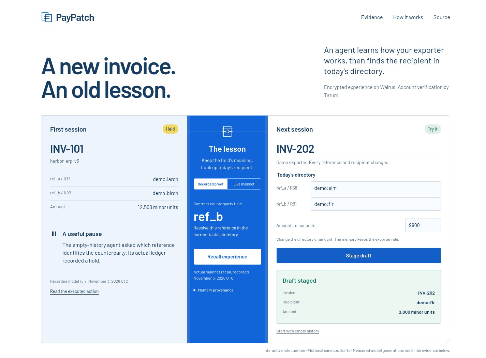

# PayPatch

**Learn an export format once. Act on the next invoice.**

An agent remembers a verified exporter convention as encrypted Walrus Memory. A fresh session retrieves it, resolves the recipient from today's directory and stages a payment draft in a fictional local ledger.

[Open the workbench](https://blucca.github.io/paypatch/) · [Watch the 2:48 demo](https://blucca.github.io/paypatch/#film) · [Technical article](docs/learning-loop.md)



## Try the next invoice

1. Stage `INV-202` with empty history: the runtime records a **hold**.
2. Recall the exporter experience: the stored lesson identifies `ref_b`.
3. Stage the draft: today's `R91` directory record resolves to `demo:fir`, 9,800 minor units.
4. Change the directory recipient or amount and stage again. The same lesson resolves the new current input.

The workbench opens in **Recorded proof** mode, reading the published actual mainnet recall. **Live mainnet** uses a read-only native reader to check the account through Tatum and retrieve that same experience from Walrus. The source and date are visible in the interface. The browser executes a deterministic draft kernel; the two measured model generations below are recorded observations.

The temporary live judging endpoint was retired on November 18, 2026 with organizer approval. Recorded proof, the source and the film remain public. [Latest sanitized native-read proof](experiment/live-read-proof-20261105.json).

## Observed learning loop

| Session | Available experience | Executed result |
|---|---|---|
| Cold: `INV-101` | Empty | `HOLD_RECORDED` — reference-field roles need clarification |
| Warm: `INV-202` | Actual native Walrus recall | `DRAFT_STAGED` — current `R91 → demo:fir`, 9,800 minor units |

Two fresh `gpt-6.1-sol` sessions used identical task instructions. The second task changed its invoice, references, amount and every recipient. Stored experience contains the first executed action receipt and the general export-profile rule. The new recipient is resolved from the second task's directory.

**Measured scope: one fictional exporter profile and two tasks.** History availability is the intervention. [Inspect the complete experiment](experiment/).

## Native integration

- The mainnet MemWal Account and delegate were registered through the official sponsored setup.
- Tatum's Sui Gateway reads the actual Account and verifies its active, authorized delegate before a memory operation.
- `@mysten-incubation/memwal` `0.1.12` stored observed feedback in `gain-totalrecall-learning379`, completed its job and returned a Walrus blob ID.
- Native recall returned that experience; a fresh agent used it in its next executed action.
- [Ten earlier pilot memories plus this learning experience](experiment/mainnet-memory-inventory.json) completed on mainnet. Their namespaces stay separate; demo reads reuse those completed records.

The live Tatum gateway advertised **GraphQL** at `https://sui-mainnet.gateway.tatum.io/graphql`. Its legacy JSON-RPC root returned HTTP 404 during integration. The adapter uses the actual advertised transport.

## Run locally

```sh
git clone https://github.com/blucca/paypatch.git
cd paypatch
npm install
npm run check
npm start
```

Open `http://127.0.0.1:17612`. Recorded proof works using the published experiment files. Set registered credentials in the environment before starting for native live recall:

```sh
export MEMWAL_PRIVATE_KEY=...  # registered Ed25519 delegate, 32-byte hex
export MEMWAL_ACCOUNT_ID=...   # existing mainnet MemWal Account
export TATUM_API_KEY=...       # mainnet Tatum key
export MEMWAL_NAMESPACE=gain-totalrecall-learning379
node cli.mjs gate
node cli.mjs recall harbor-erp-v3
npm start
```

`GET /api/recall` returns a sanitized operating rule, receipt provenance and account-gate flags for the published learning experience. It performs native reads and keeps one result for up to a minute to absorb repeated clicks. Credentials and account identifiers stay server-side. Public operation serves fictional experiment reads and local draft actions.

For new observed episodes, select your own namespace explicitly:

```sh
MEMWAL_NAMESPACE=your-exporter-profile node cli.mjs remember your-reviewed-experience.json
```

Writes print their accepted job ID followed by the completed result. Preserve the accepted receipt when resuming an interrupted write.

## Reproduce the result

```sh
npm run check
```

The recorded check verifies identical instructions, actual HOLD and draft actions, future-identifier isolation, exact native stored/returned experience, completed memory proof, recipient identity, minor-unit amount and ledger contents. The interactive kernel check covers new directory identities and amounts, absent history, different profiles and invalid amounts.

`experiment/` contains the frozen contract, prompts, actions, trusted feedback, stored and recalled experience, native proof and resulting ledger. Public account identifiers are redacted; exact original API responses and credentials remain in private storage.

Built with Codex for Walrus × Tatum Total Recall. All business examples are fictional; execution creates sandbox drafts.
